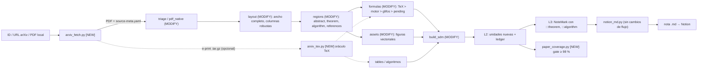

# Plan: adaptar `notemartin-study-notes` para PDFs de artículos arXiv

## Goal Description

Verificar si la skill [`notemartin-study-notes`](file:///Users/martin/Desktop/projects/Skills/notemartin-study-notes/skill/notemartin-study-notes/SKILL.md) está lista para recibir PDFs de arXiv y producir **notas en Markdown listas para exportar a Notion**, con una **completitud ≥ 98 %** del contenido del paper. Si no lo está, definir los pasos para llegar.

El flujo de salida no cambia: `NoteMark → IR → notion_md.py → .md → Notion`. Los cambios son de **ingesta, modelo de contenido y medición**.

## Veredicto

> [!IMPORTANT]
> **La skill NO está adaptada para arXiv.** Hoy trata un paper como "PDF nativo genérico". Funciona para outline, encabezados y texto corrido, pero **no puede garantizar 98 %** porque falla en fórmulas, teoremas, algoritmos, figuras vectoriales y metadatos, y **no tiene una métrica que mida ese 98 %**.

### Evidencia empírica

Corrí `triage.py`, `pdf_native.py` y `layout.py` sobre [`evals/corpus/04-arxiv-two-column/sample.pdf`](file:///Users/martin/Desktop/projects/Skills/notemartin-study-notes/evals/corpus/04-arxiv-two-column/sample.pdf). No modifiqué nada del repo. Las salidas están en `scratch/`.

| Hallazgo | Dato medido |
|---|---|
| Outline desde bookmarks PDF | ✅ 11 entradas correctas (Intro, Refs, Apéndices A–C) |
| Estampa `arXiv:2201.00001v3 [math.NA]` | ⚠️ sale como texto suelto (p.1, bbox `[32,222,452,242]`); no se usa como metadato |
| Ligaduras `fi fl` | ❌ quedan en el texto (`Traffic`, `flow`). `post_ocr.py` las corrige solo en la ruta OCR |
| Matemática | ❌ cada glifo es un fragmento (`CMMI10 'L'`, `CMMI7 'adv'`, `CMSY10 '−∇·'`). No se reconstruye ninguna ecuación |
| Sub/superíndices | ❌ 446 de ~1460 fragmentos quedan con rol `footnote` (son índices matemáticos mal clasificados) |
| Teoremas, pruebas, algoritmos | ❌ `Theorem 2.1.`, `Proof.`, `Algorithm 1` salen como `body` sin tipo |
| Abstract y bloque de autores | ❌ salen como `body` (no hay clase `abstract` ni `author_block`) |
| Detección de columnas | ❌ en un paper de 8 páginas `layout.py` detecta 1, 3, 4 y 5 columnas según la página. `continuity_score ≈ 0.2` y `out_of_flow_count` 23 de 30 en p.2, pero `reading_order_valid: true`. El validador no detecta el problema |
| Referencias | ⚠️ cada `[n] Autor…` es un fragmento, pero no hay bloque `references` ni resolución de citas `[4, 18]` |
| Figuras vectoriales | ❌ `assets.py` solo extrae imágenes raster (XObjects). Las figuras de arXiv suelen ser vectoriales |
| Fixtures | ⚠️ la tarjeta `04` dice "FoundationDB, cs.DB, ~15 págs, dos columnas". La muestra real es `2201.00001`, `math.NA`, 8 págs. La aserción `two-column-reading-order` nunca se ejerció con un paper de dos columnas real |

### Estado por capacidad

| Capacidad | Estado | Razón |
|---|---|---|
| Triage / texto nativo / outline | ✅ Listo | `pdf_native.py` funciona |
| Metadatos arXiv (ID, versión, categorías, DOI, licencia, autores) | ❌ Falta | `source_provenance` no tiene esos campos y no hay descarga |
| Entrada por ID o URL | ❌ Falta | `triage.py` y `pdf_native.py` solo aceptan archivo local |
| Orden de lectura en 2 columnas con elementos de ancho completo | ⚠️ Débil | Ver hallazgo de columnas |
| Fórmulas | ❌ Falta | `formulas.md` §4: *"En v1 NO se invoca pdflatex, pix2tex ni Nougat"*. Solo valida LaTeX ya existente |
| Teoremas / pruebas / algoritmos | ❌ Falta | `sdm.schema.json` `blockType` no los incluye |
| Tablas | ⚠️ Parcial | `tables.py` existe; falta probar tablas *booktabs* (sin líneas verticales) |
| Figuras vectoriales | ❌ Falta | Solo raster |
| Bibliografía y citas | ❌ Falta | Sin tipo de bloque ni de unidad |
| Exportar a Notion (`notion_md.py`) | ✅ Listo | `equation → $$…$$` ya existe |
| Métrica "≥ 98 % del paper" | ❌ Falta | El ledger exige 100 % de `must-keep`, pero no mide cobertura ponderada por contenido |

## User Review Required

> [!IMPORTANT]
> **Cambios de contrato.** Según [`agent.md`](file:///Users/martin/Desktop/projects/Skills/notemartin-study-notes/agent.md) §2, cualquier cambio en el shape de `sdm.json`, `ledger.json` o `note-ir.json` exige un ADR previo. Este plan toca `sdm.schema.json` (nuevos `blockType` y `origin`), `ledger.schema.json` (nuevos tipos de unidad) y `source_provenance`. Son cambios **aditivos** → `VERSION 0.1.0 → 0.2.0` (MINOR, según `VERSIONING.md`).

> [!NOTE]
> **Tu respuesta a la pregunta de tipo de nota.** Dijiste que la skill entrega notas en `.md` para exportar a Notion, que quieres seguir así y que el objetivo es ≥ 98 %. Lo interpreto como: **no cambiar el flujo de salida ni agregar un 16º tipo de nota en esta iteración**. Detalle en "Open Questions".

## Open Questions

> [!IMPORTANT]
> **1. Tipo de nota para un paper.** Propongo reutilizar `chapter-digest` con un *overlay* de secciones para papers (§P5). Evita tocar `note-plan` y los 15 `references/05-note-types/*.md`. Si prefieres un 16º tipo `paper-summary`, el costo sube: ADR, enum en `note-plan.schema.json`, selector `selector.md`, checklists y evals. ¿Confirmas la opción de reutilizar?

> [!IMPORTANT]
> **2. Definición de "98 %".** Propongo: **proporción de palabras del cuerpo del paper** (excluyendo boilerplate y ruido de página) cubiertas por unidades `written` o `merged`. Las referencias bibliográficas se conservan completas y cuentan como cubiertas. Además, el 100 % de ecuaciones numeradas, teoremas, algoritmos y tablas sigue siendo bloqueante (`INV-08`). ¿Es la métrica que quieres, o prefieres cobertura por secciones?

> [!NOTE]
> **3. Idioma de la nota.** ¿Se redacta en español, con términos técnicos en inglés en la primera aparición (como en `i18n-and-citation.md`), o en inglés?

## Decisiones ya tomadas

- **Alcance de entrada:** PDF local **y** descarga por ID/URL de arXiv, con metadatos de la API. Si existe fuente LaTeX, se usa como oráculo.
- **Fórmulas:** cascada en 3 niveles: fuente LaTeX → motor externo opcional → reconstrucción por heurística de glifos con recorte `pending`.

## Arquitectura propuesta



## Proposed Changes

Orden por dependencias. Cada fase termina con evidencia medible antes de pasar a la siguiente.

---

### P0 · Línea base y fixtures

Sin esta fase no hay forma de medir el avance.

#### [MODIFY] `evals/corpus/04-arxiv-two-column/card.md`
Corregir la tarjeta para que coincida con la muestra real (`2201.00001`, `math.NA`, 8 págs) y documentar el sha256 real.

#### [NEW] `evals/corpus/15-arxiv-two-column-real/` (+ `card.md`)
Un paper arXiv de dos columnas **real** (IEEE/ACM, p. ej. cs.DB o cs.DC) con licencia CC-BY. Es el que ejerce la aserción `two-column-reading-order`.

#### [NEW] `evals/arxiv-baseline/measure_baseline.py`
Script que calcula sobre un PDF: % de palabras con ligaduras sin normalizar, nº de fragmentos matemáticos sueltos, nº de columnas detectadas por página, y `continuity_score`. Guarda `baseline.json` para comparar antes/después.

---

### P1 · Adquisición y metadatos arXiv

#### [NEW] `scripts/ingest/arxiv_fetch.py`
Resuelve ID o URL y descarga los insumos.

- Acepta `2201.00001`, `2201.00001v3`, `hep-th/9901001`, `arxiv.org/abs/…`, `arxiv.org/pdf/…`.
- Descarga el PDF de `https://arxiv.org/pdf/<id>v<n>`.
- Metadatos desde `export.arxiv.org/api/query?id_list=<id>`: título, autores, abstract, categorías, DOI, `journal_ref`, versión, fechas, licencia.
- Fuente LaTeX opcional desde `https://arxiv.org/e-print/<id>` (tar.gz). Puede no existir; se registra `tex_available: false`.
- Respeta los términos de uso de arXiv: espacio de ~3 s entre peticiones y `User-Agent` identificable.
- Emite `source-meta.yaml` (entrada de `build_sdm.py --source-meta`) con `method: read`, confianza 1.0.
- Solo `urllib` de la stdlib (patrón de `notion_api.py`).

```bash
python3 scripts/ingest/arxiv_fetch.py --id 2201.00001 --out-dir .notes-work/<hash>/ [--with-tex]
```

#### [MODIFY] `schemas/sdm.schema.json` y [`provenance.md`](file:///Users/martin/Desktop/projects/Skills/notemartin-study-notes/skill/notemartin-study-notes/references/02-source-model/provenance.md)
Agregar campos `arxiv_id`, `arxiv_version`, `categories[]`, `doi`, `license`, `journal_ref`. Agregar `method: arxiv_api` al enum. Agregar `arxiv` a `source.format` solo como metadato (el formato sigue siendo `pdf`).

#### [MODIFY] `scripts/ingest/pdf_native.py`
Reconocer la estampa lateral `arXiv:<id>v<n> [cat] <fecha>` y marcarla como `boilerplate` con el valor capturado como metadato (fuente de respaldo si no se usó `arxiv_fetch`).

---

### P2 · Ingesta PDF específica de papers

#### [MODIFY] `scripts/ingest/pdf_native.py`
- **Ligaduras:** normalizar `fi fl ffi ffl ff` → `fi fl ffi ffl ff` en la ruta nativa. Reutilizar la tabla `LIGATURES` de `post_ocr.py` moviéndola a `scripts/util/`.
- **Guiones de fin de línea:** unir `trans-` + `port` cuando la siguiente línea empieza en minúscula. Conservar compuestos legítimos (`well-known`). Registrar cada unión para que sea reversible.
- **Sub/superíndices:** clasificar por desplazamiento de línea base y tamaño relativo (≈ 0.7 del modal) y no como `footnote`. Esto corrige los 446 fragmentos mal clasificados.

#### [MODIFY] `scripts/ingest/layout.py`
- Detectar **elementos de ancho completo** (título, abstract, `figure*`, `table*`, ecuaciones anchas). Cortan el flujo de columnas y se leen antes o después de las columnas, según su posición Y.
- Evitar falsos positivos de columnas causados por bloques de autores en tres columnas y por matemática: exigir densidad mínima de líneas por columna y consistencia entre páginas del mismo documento (la mayoría decide).
- Que `reading_order_valid` dependa de `continuity_score` con un umbral (hoy 0.2 pasa como válido).
- Preservar notas al pie al pie de su columna.

#### [MODIFY] `scripts/ingest/regions.py` y [`regions.md`](file:///Users/martin/Desktop/projects/Skills/notemartin-study-notes/skill/notemartin-study-notes/references/01-ingest/regions.md)
Hoy hay 13 clases. Agregar:

| Clase nueva | Señal principal |
|---|---|
| `abstract` | Encabezado "Abstract" + bloque hasta el primer encabezado numerado |
| `author_block` | Fragmentos antes del abstract con emails / afiliaciones |
| `theorem_like` | `^(Theorem|Lemma|Proposition|Corollary|Definition|Remark|Claim|Proof)\b` + numeración; cierre `∎` o `□` |
| `algorithm` | `^Algorithm \d+` + líneas numeradas / palabras clave (`for`, `while`, `return`) |
| `references` | Sección "References" / "Bibliography"; entradas `[n]` |
| `appendix_heading` | Encabezado `^[A-Z](\.\d+)?\s` tras el último numerado |

---

### P3 · Fórmulas (el mayor riesgo para el 98 %)

#### [NEW] `scripts/ingest/arxiv_tex.py`
Oráculo LaTeX cuando existe la fuente.

- Desempaqueta el e-print, localiza el `.tex` principal (`\documentclass`) y aplana `\input` / `\include`.
- Extrae entornos: `equation`, `align`, `gather`, `multline`, `theorem`/`lemma`/…, `proof`, `algorithm`/`algorithmic`, `tabular`/`table`, `figure` (captions), `thebibliography`/`.bbl`.
- Extrae las macros del preámbulo (`\newcommand`, `\DeclareMathOperator`, `\def`) para expandirlas (Notion/KaTeX no las conoce).
- Alinea con el PDF por **número de ecuación y orden** y adjunta `latex` y `latex_source: tex` a las regiones `formula`.
- Es opcional: sin e-print o con parse fallido, el pipeline sigue por la cascada.

#### [MODIFY] `scripts/ingest/formulas.py` y [`formulas.md`](file:///Users/martin/Desktop/projects/Skills/notemartin-study-notes/skill/notemartin-study-notes/references/01-ingest/formulas.md)
Nueva cascada por fórmula:

1. **TeX oráculo** (si `arxiv_tex.py` produjo match).
2. **Motor externo opcional** (`--math-engine marker|nougat|pix2tex`), detectado en `check_deps.py` como nivel `opt`. Si no está instalado se salta sin error.
3. **Reconstrucción por glifos** de la capa nativa: agrupar fragmentos por línea y solapamiento vertical, mapear fuentes CM (`CMMI`, `CMSY`, `CMR`, `CMEX`, `MSBM`) a comandos LaTeX, inferir `_` / `^` por línea base, detectar barras de fracción.
4. Validar con el `LaTeXValidator` existente. Si falla → `pending: true` con recorte de imagen.

Cada fórmula guarda `latex_source ∈ {tex, engine, glyphs, pending}` para auditoría. Cambiar `formulas.md` §4 (que dice "v1 sin motor") a v2.

#### [MODIFY] `scripts/ingest/formulas.py` (recorte)
`crop_image_to_bbox` solo recorta imágenes de página ya rasterizadas. Para PDFs nativos, rasterizar la región con `pypdfium2` (ya es dependencia `rec`).

> [!WARNING]
> Sin fuente TeX ni motor externo, la reconstrucción por glifos no será perfecta en ecuaciones complejas (matrices, `align` con varias columnas). Esas quedarán `pending` con imagen, y el agente las transcribe mirando el recorte. Esto es lo que más afecta al 98 %, por lo que `--with-tex` debería ser el camino recomendado cuando el paper lo permita.

---

### P4 · Figuras y tablas

#### [MODIFY] `scripts/ingest/assets.py`
- Detectar figuras **vectoriales**: anclar en el caption `Figure N:` y recortar la región entre el texto previo y el caption, rasterizando con `pypdfium2` a 200 DPI.
- Asociar el caption como `alt` (ya existe `CAPTION_MAX_PAGES_AHEAD`).
- Clasificar `data_figure` / `diagram_conceptual` con las heurísticas actuales.

#### [MODIFY] `scripts/ingest/tables.py`
- Soportar tablas *booktabs* (solo líneas horizontales; clusterización por alineación X).
- Con TeX disponible, usar `tabular` como oráculo del contenido de celdas.

---

### P5 · Conocimiento y autoría

#### [MODIFY] `schemas/sdm.schema.json`
- `blockType`: agregar `abstract`, `theorem`, `proof`, `algorithm`, `reference-list`, `reference-entry`.
- `origin`: agregar `source_tex`.

#### [MODIFY] [`information-units.md`](file:///Users/martin/Desktop/projects/Skills/notemartin-study-notes/skill/notemartin-study-notes/references/03-knowledge/information-units.md) y `schemas/ledger.schema.json`
Tipos de unidad nuevos:

| Tipo | Criticidad | Notas |
|---|---|---|
| `theorem` | must-keep | Enunciado literal (INV-09) |
| `proof` | must-keep | Conservar pasos; si es muy larga, plegable en L3, nunca omitida |
| `algorithm` | must-keep | Líneas numeradas preservadas |
| `claim-result` | must-keep | Resultados numéricos de tablas y texto |
| `experimental-setup` | context | Datasets, hiperparámetros |
| `bibliography-entry` | context | Se conserva entera |

La ecuación numerada ya es `must-keep` (regla R de `formula` con `numbered: true`).

#### [MODIFY] [`block-directives.md`](file:///Users/martin/Desktop/projects/Skills/notemartin-study-notes/skill/notemartin-study-notes/references/04-authoring/block-directives.md), `notemark.ebnf`, `ir-spec.md`
- `:::theorem`, `:::proof` (colapsable), `:::algorithm`.
- Marca inline de cita `[cite:n]` que enlaza a la entrada en `## Referencias`.

#### [MODIFY] `scripts/render/notion_md.py`
- `:::theorem` → callout con emoji y etiqueta (`Theorem 2.1`).
- `:::proof` → `<details>`.
- `:::algorithm` → bloque de código `text` con líneas numeradas.
- Saneamiento de LaTeX para el importador de Notion: eliminar `\label`, `\tag` no soportado y `\nonumber`; usar las macros ya expandidas por `arxiv_tex.py`.
- Con `--include-import-instructions` documentar la importación en Notion.

#### [NEW] `references/05-note-types/paper-overlay.md` (si se confirma la Pregunta 1)
Plantilla de secciones para `chapter-digest` aplicado a un paper:

`Cabecera (arXiv ID, versión, autores, categorías, DOI, licencia)` → `TL;DR` → `Abstract (literal)` → `Contribuciones` → `Notación y símbolos` → `Método` → `Teoremas y pruebas` → `Algoritmos` → `Experimentos (setup, datasets)` → `Resultados (tablas)` → `Limitaciones` → `Apéndices` → `Referencias` → `Autoevaluación`.

---

### P6 · Medición del 98 % y calidad

#### [NEW] `scripts/validate/paper_coverage.py`
Calcula y reporta:

- **Cobertura ponderada por palabras** = Σ palabras de bloques con unidad `written|merged` ÷ Σ palabras del cuerpo (excluye `boilerplate`, números de página).
- Desglose por categoría: prosa, ecuaciones, teoremas/pruebas, algoritmos, tablas, figuras (captions), apéndices, referencias.
- `discarded` solo cuenta como cubierto si la razón está en una lista cerrada (`boilerplate`, `duplicate`).
- Gate: ≥ 0.98 global **y** 1.0 en ecuaciones numeradas, teoremas, algoritmos, tablas.
- Conteo de referencias: nº de `bibliography-entry` en la nota = nº en la fuente (regex `^\[\d+\]`, o `bibitem` con TeX).
- Resolución de citas: toda `[n]` del cuerpo apunta a una entrada existente.
- Exit codes 0/1/2 igual que `completeness.py`.

#### [MODIFY] `scripts/quality_gate.py`, `schemas/quality-gate.schema.json`, `scripts/validate/run_all.py`
Integrar `paper_coverage` como validador condicional (perfil con `source_kind: arxiv`).

#### [MODIFY] `evals/suite/` y `evals/regression/`
- Nuevo `case-12-arxiv-formulas` (hoy marcado "no dedicado" en `PROMPTS.md`) y `case-15-arxiv-two-column-real`.
- Aserciones nuevas en `check_assertions.py`: `paper_coverage`, `equation_fidelity` (fracción con `latex_source != pending`), `citation_resolution`.
- Actualizar `SET.md` de regresión (límite blando de 12 casos; hoy hay 6).

---

### P7 · Integración y documentación

#### [MODIFY] `SKILL.md`
- Hoja nueva del árbol de §3: *"arXiv (ID/URL/PDF)" → `arxiv_fetch.py`*.
- Filas de §5 para `references/01-ingest/arxiv.md` y `paper-overlay.md`.
- Filas de §6 para `arxiv_fetch.py`, `arxiv_tex.py`, `paper_coverage.py`.
- Límite duro 500 líneas (`INV-02`); hoy 311.

#### [NEW] `references/01-ingest/arxiv.md`
Normativa de la ruta arXiv: orden de ejecución, política de red, cascada de fórmulas, qué se hace cuando falta TeX.

#### [MODIFY] `PROMPTS.md`, `README.md`, `docs/galaxy.md`
Prompt "arXiv → Notion" copy-paste, corrección de la fila 04, nueva fila 15.

#### [NEW] `docs/adr/ADR-00NN-arxiv-paper-support.md`
Triada regla → motivación → prueba. Cubre nuevos `blockType`, `origin`, unidades, y la política de red.

#### [MODIFY] `CHANGELOG.md`, `VERSION`, `COMPATIBILITY.md`, `ROADMAP.md`
Fases nuevas (F126+), release `0.2.0`.

#### [MODIFY] `scripts/pkg/deps.yaml`
Motores de matemática como `opt`. Sin dependencias `req` nuevas.

## Orden y esfuerzo estimado

| Fase | Entrega | Esfuerzo | Impacto en el 98 % |
|---|---|---|---|
| P0 | Línea base + fixtures | S | Habilita medir |
| P1 | arXiv fetch + metadatos | S | Bajo (metadatos) |
| P2 | Ligaduras, guiones, columnas, clases | M | Alto (texto = mayor parte de las palabras) |
| P3 | Fórmulas | L | **Muy alto** y mayor riesgo |
| P4 | Figuras, tablas | M | Medio |
| P5 | Unidades, directivas, Notion | M | Alto (sin esto teoremas/algoritmos se pierden) |
| P6 | Métrica + gate + evals | M | Verifica el objetivo |
| P7 | Docs, ADR, release | S | — |

**Ruta mínima viable** (≈ 80 % del beneficio): P0 → P2 → P5 → P6, con P3 limitado a "TeX oráculo + `pending` con imagen". Después P1 y el resto.

## Verification Plan

### Automated Tests

```bash
# Línea base antes/después (P0)
python3 evals/arxiv-baseline/measure_baseline.py --pdf evals/corpus/04-arxiv-two-column/sample.pdf --out baseline.json

# Metadatos y descarga (P1) — pruebas con red y con fixture offline
python3 scripts/ingest/arxiv_fetch.py --id 2201.00001 --out-dir /tmp/ax --with-tex

# Cobertura (P6): debe dar ≥ 0.98 global y 1.0 en categorías críticas
python3 scripts/validate/paper_coverage.py --sdm <sdm.json> --ledger <ledger.json> --ir <ir_dir> --min 0.98

# Suite y regresión del proyecto
python3 evals/suite/runner/drive_suite.py
python3 evals/suite/runner/run_regression.py --case-dir evals/regression/cases/ --release-tag 0.2.0-dev --out-dir <dir>
python3 scripts/check_pr.py --all
python3 scripts/check_version.py --all
python3 scripts/build_skill.py && python3 scripts/smoke_test.py --skill dist/<release>.skill
```

Criterios de aceptación medibles sobre los 2 papers reales (04 y 15):

| Métrica | Hoy | Meta |
|---|---|---|
| Ligaduras sin normalizar | > 0 | 0 |
| Columnas detectadas por página (paper de 2 columnas) | 1–5, inestable | 2 (o 1 en ancho completo) en ≥ 95 % de páginas |
| Sub/superíndices clasificados como `footnote` | ~446 | ≈ 0 |
| Ecuaciones numeradas con LaTeX (`latex_source != pending`) | 0 % | ≥ 90 % con TeX; ≥ 60 % sin TeX (el resto `pending` con imagen) |
| Teoremas, pruebas, algoritmos tipados | 0 | 100 % |
| Referencias conservadas / citas resueltas | no medido | 100 % / 100 % |
| **Cobertura ponderada global** | no medida | **≥ 98 %** |

### Manual Verification

1. Correr el prompt de `PROMPTS.md` con un paper arXiv (ID real) y exportar `render/notion_md/*.md`.
2. Importar el `.md` en Notion y revisar: ecuaciones `$$` renderizadas, teoremas como callouts, pruebas plegadas, algoritmos legibles, figuras presentes, referencias completas con citas enlazadas.
3. Comparar contra el PDF: abrir 3 secciones al azar y confirmar que no falta ningún párrafo, ecuación numerada ni tabla.
4. Revisar los `pending` con imagen y confirmar que su transcripción es fiel.

## Riesgos

| Riesgo | Mitigación |
|---|---|
| Matemática compleja sin TeX ni motor | `pending` con imagen + revisión del agente; recomendar `--with-tex` |
| Fuente TeX no disponible o con macros exóticas | Cascada con fallback; macros expandidas solo si hay match |
| API / descarga de arXiv caída o con límite | Cache por hash (`sdm_cache.py`), reintentos con backoff, modo offline con PDF local |
| Notion rechaza LaTeX no soportado | Saneamiento + lista de macros soportadas; ecuaciones problemáticas degradan a bloque de código con declaración en `render-degradation.md` |
| `SKILL.md` crece (límite 500 líneas) | Todo el detalle va en `references/`; solo se agregan filas de enrutado |
| Reabrir fases cerradas (F18, F21, F22, F24) | ADR con cambio aditivo; no se modifican contratos existentes |
